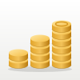

# Mirador

*Know where you stand. See where you're going.*

**A free, self-hosted, open source personal finance app that shows you where your money goes and steers it toward your goals in minutes a week, not hours.**

A *mirador* is a lookout: the spot on a trail where you stop and see the whole picture. Mirador does that for your money. It starts from how you actually spend, not from an ideal budget, and suggests changes you have already shown you can live with.

> **Status: early, in active development.** Version 0.3.0 works for wallets and transactions; import, analysis, the budget and the dashboard come next. The work is tracked as issues on the [project board](https://github.com/users/MAlejandroVC/projects). Contributions are welcome; start with [CONTRIBUTING.md](CONTRIBUTING.md).

## What it does today

- **Your own account, end-to-end encrypted.** Sign in with a password or a passkey; a recovery key gets you back in if you forget the password.
- **Wallets, net worth and net debt.** Cash, cards, savings, investments and loans in one place, with interest, fees, credit limits and statement balances where they apply.
- **Transactions**, period by period, sorted and filtered your way, with one category and any number of tags each, plus recurring transactions and purchases paid in installments.
- **Your own categories.** Category groups, categories and tags you define; every account starts with a complete set you can change, and nothing is hard-coded.
- **Made to feel at home on your phone**, in English or Spanish, with eight palettes in light and dark, and installable on the Home Screen.

## What comes next

- **Statement and image import.** Upload a CSV, PDF, screenshot or a photo of a ticket; the app extracts the transactions on your own server and only asks about the rows it is unsure of.
- **Spending analysis** that answers where, when and why the money goes, and where cutting back would be easiest.
- **A habit-driven, goal-oriented budget.** It starts from your real typical month, adds your goals, and closes the gap with cuts no deeper than levels you have already reached.
- **A dashboard** that tells you in one glance whether you are on track this period.
- **Quick add** on every screen, that also works offline and syncs later.
- **Full export and import** in documented, open formats.

## Principles

- **Private by default.** Your data is end-to-end encrypted: only your devices can read it, not even the server that stores it. The app talks to nothing else: no bank credentials, no telemetry, no remote AI.
- **Habits before targets.** Every budget number starts from observed behaviour.
- **Capture must be near-free.** Import does the bulk; manual entry covers the gaps in seconds.
- **You own the taxonomy and the data.** Everything goes in and out in open formats.

## How it runs

Mirador is a phone-first web app (installable as a PWA) talking to a server you host yourself: a TypeScript server with PostgreSQL, shipped as one Docker image. Run it on a cheap web host, a VPS or a home machine; every device you sign in from shows the same data. The server only ever stores encrypted data, and a recovery key shown once at sign-up is the only way back in if you forget your password. Native apps may follow later if there is interest.

To run your own, follow [docs/self-hosting.md](docs/self-hosting.md).

## Documentation

| Document | What it covers |
| --- | --- |
| [Functional Requirements Specification](docs/requirements.md) | What to build: every requirement, with its ID and priority |
| [Technology Stack](docs/technology-stack.md) | What we build it with, and why |
| [Design language](docs/design-language.md) | How it looks, behaves and writes: every rule, with its ID |
| [Self-hosting](docs/self-hosting.md) | Running the Docker image with PostgreSQL and HTTPS, and keeping it updated |
| [What the server sees](docs/what-the-server-sees.md) | Everything the server stores about its users, and what it can never read |
| [CONTRIBUTING.md](CONTRIBUTING.md) | How we work: setup, layout, code rules, issues, branches, commits, tests, releases |
| [docs/](docs/) | Everything else, including architecture decision records |

## Contributing

Pick an issue labelled `good first issue` or any issue in the **Ready** column of the board, comment that you are taking it, and follow [CONTRIBUTING.md](CONTRIBUTING.md). Questions and ideas go in [Discussions](https://github.com/MAlejandroVC/mirador/discussions). Please read the [Code of Conduct](CODE_OF_CONDUCT.md), and report security problems as described in [SECURITY.md](SECURITY.md).

## License

Mirador is free software under the [GNU Affero General Public License v3.0](LICENSE). If you run a modified version for other people, you must offer them its source code.
