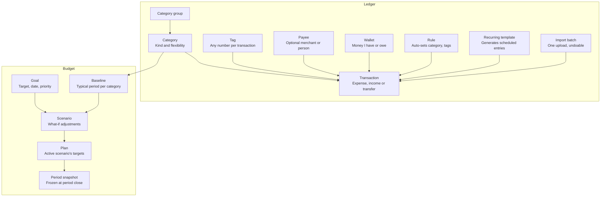
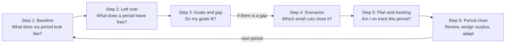

# Mirador: Functional Requirements Specification

## About this document

This spec is a lean Software Requirements Specification. It follows the ISO/IEC/IEEE 29148 section structure, adds product context (goals, assumptions, open questions, out of scope), and writes every requirement as one testable EARS sentence with an ID and a priority.

**How to read a requirement**

- **ID**: `AREA-NN` (WAL wallets, TXN transactions, IMP import, CAT categories and tags, ANA analysis, BUD budget, DSH dashboard, WID quick add, DAT data, SYS settings, SEC security, NFR non-functional). IDs are never reused; a dropped requirement is struck through, not renumbered.
- **EARS patterns**: *The app shall…* (always) · *When \<event\>, the app shall…* · *While \<state\>, the app shall…* · *Where \<feature is enabled\>, the app shall…* · *If \<unwanted situation\>, then the app shall…*
- **Priority (MoSCoW)**: **Must** = needed for the first usable release (MVP) · **Should** = v1, but MVP can ship without it · **Could** = nice to have · **Won't** = explicitly not now · **TBD** = waiting on an open question.
- **"The app"** means Mirador: the web application the user opens in a browser on their phone or computer, together with the self-hosted server it syncs with, including quick add.
- **Acceptance criteria** are given as Given/When/Then where behaviour is subtle (import, budget). For the rest, the EARS sentence is the test.

**How to use it**: each Epic section becomes an epic on the GitHub project board; each requirement ID becomes an issue (ID in the issue title); each open question becomes a decision issue. When an open question is decided, its answer moves into the relevant epic as a requirement and the question is closed.

## Vision, scope and principles

Mirador is a free, self-hosted, open source personal finance tool that shows people where their money goes and steers it toward their goals in minutes a week, not hours. Version 1 is a responsive web app, built first for heavy use on a phone, that syncs every device through a server the user runs themselves; native apps may follow if there is interest. It starts from how the user actually spends, not from an ideal budget.

**The problem it solves**

- Fully manual logging is slow and tedious, so most people quit within weeks.
- Bank-API aggregation means handing credentials to third parties, and the integrations break and need constant maintenance.
- Classic budgets rest on unrealistic assumptions ("cut dining in half"), so the targets either can't be kept or hurt too much to keep, and users give up.

**Product goals** (proposed targets, to confirm)

| ID | Goal | Target |
|---|---|---|
| G1 | Logging a manual expense is effortless | ≤ 10 seconds and ≤ 3 inputs from quick add |
| G2 | Importing history is fast | One monthly statement imported in ≤ 2 minutes, one tap when nothing is flagged |
| G3 | A budget appears without typing numbers | Baseline generated automatically from ≥ 1 month of history |
| G4 | Status is obvious | "Am I on track this period?" answered from the dashboard in ≤ 5 seconds |
| G5 | Users own their data | Full export and re-import with no data loss |

**In scope**: wallets and net worth, transactions, statement and image import, user-defined category groups, categories and tags, spending analysis, the habit-driven goal-oriented budget, the main dashboard, quick add, and full data export and import.

**Guiding principles** (used to settle disputes between requirements)

1. **P****rivate by default.** Data is encrypted on the user's device before it reaches the server, and the server cannot read it. The app never asks for bank credentials.
1. **Habits before targets.** Every budget number starts from observed behaviour and moves in steps the user has shown they can take.
1. **Capture must be near-free.** Import does the bulk; manual entry covers the gaps in seconds. Every extra field or confirmation has to earn its place.
1. **The user owns the taxonomy.** No category or tag is hard-coded; every screen adapts to the user's categories and tags.
1. **Realistic, not ideal.** Targets and goals must be ones the user can actually sustain without too much pain; the app shows the numbers behind every suggestion.
1. **Open data.** Everything goes in and out in documented, open formats.

## Users and personas

The primary user is a busy person with several cards and wallets who wants to reach a financial goal without becoming a bookkeeper. Every requirement is judged first against their needs.

| Persona | Context | Needs | Success looks like |
|---|---|---|---|
| **The busy improver** (primary) | Salaried, 2 to 6 wallets including credit cards, spends on the go, has a goal (car, trip, investing) | Low-effort capture, a clear "am I OK this period", a realistic plan | Checks in a few minutes a week and hits goals without feeling restricted |
| **The privacy-minded tinkerer** (secondary) | Prefers local, open source software, may contribute code | Data on their own server, open formats, backups | Never worries about where the data lives and can take it anywhere |

**Assumptions**

- Each person signs in with their own account and sees only their own data. There is no sharing or communication between users in V1.
- V1 keeps all data on one self-hosted server that every device signs in to. Whoever runs it chooses how to host and reach it: a cheap web host, a VPS, or a home server behind a VPN.
- Users have at least one month of statements or screenshots to import, or are willing to log for a month before the budget becomes useful.

## Glossary

These terms have one meaning throughout the document, the code and the UI.

| Term | Meaning |
|---|---|
| Wallet | A place money lives or is owed: cash, a debit or credit card, a savings or investment account, a loan, a voucher card. All wallets work the same way; a type is only a preset of optional features. |
| What I have | The sum of all wallets with a positive balance. |
| What I owe | The sum of all wallets with a negative balance, shown as a positive amount. Also called net debt. |
| Net worth | The sum of all wallet balances (what I have minus what I owe). |
| Opening balance | An ordinary transaction that sets a wallet's starting amount; its date and amount can be moved to load older history. |
| Transaction | One money movement: an expense, an income or a transfer. |
| Transfer | Money moved between two of the user's own wallets. Not income, not spending. Paying a credit card is a transfer. |
| Installment plan | A purchase paid in equal monthly parts (in Mexico, "meses sin intereses" or "con intereses"). On a credit card it takes the whole amount off the available credit at once; on any other wallet each part leaves on its day. It counts in spending one installment per month. |
| Statement balance | What a credit card statement billed, minus the payments since: paying it by the due date avoids interest. Installments not billed yet are not part of it. |
| Recurring transaction | A template that adds the same transaction on a schedule, by itself or after the user confirms it. |
| Split | One transaction divided across several categories. |
| Category | A user-defined label for what money was spent on or earned from ("Lunch"). Every expense and income has exactly one. |
| Category group | The super-category a category belongs to ("Food & drinks"). |
| Tag | A free label adding context a category can't ("work", "family", "partner", "trip-cancun"). A transaction can have any number of tags, including none. |
| Payee | The optional merchant or person on the other side of a transaction. Kept for now, to revisit in a UX review of friction points. |
| Import batch | All transactions created from one upload, kept together so they can be undone as a unit. |
| Flagged row | An imported row the app is unsure about (low confidence, probable duplicate, possible transfer, no category). Only flagged rows need the user's attention. |
| Rule | A user-defined "if the description matches X, then set category Y and tags Z" instruction applied on import. |
| Recurring transaction | A template that generates expected transactions on a schedule (rent, subscriptions, fees). |
| Budget period | The span a budget covers: one month long, starting on a day the user chooses (for example payday). |
| Baseline | The user's typical period per category (optionally per category and tag), computed from history. The starting point of every budget. |
| Proven level | A category's lowest period in the lookback: spending the user has already shown they can live with. |
| Flexibility | A category's budget attribute: **Locked** (non-negotiable), **Fixed** (changes only by hand) or **Flexible** (discretionary, can be suggested for cuts). |
| Left over | Baseline income minus baseline expenses: what a typical period leaves free. |
| Goal | Something the user is saving or paying toward, with a target amount and a date or periodic contribution, or an affordability question. |
| Funding gap | Money the goals need per period minus the left over. Positive means the goals don't fit yet. |
| Scenario | A what-if copy of the baseline with adjustments to categories, income or goals. |
| Plan | The scenario the user activated; it sets each period's target per category. |
| Glide path | An adjustment phased in over several periods instead of applied at once. |
| Pace | Expected spending to date given the user's usual pattern within a period. |
| Period close | The review at the start of a period that settles the previous one. |

## Domain model

Every transaction belongs to one wallet and, unless it is a transfer, exactly one category, plus any number of tags. The budget objects are computed from transactions and never typed in by hand. This is a conceptual model for shared vocabulary, not a database schema.

Transactions are the hub; the budget is computed from them.

Arrows point from what feeds into what. Imports, recurring templates and rules create or shape transactions; the baseline is computed per category from them; scenarios adjust the baseline for goals; the activated scenario becomes the plan, frozen into a snapshot at each period close.

## Epic 1: Wallets, net worth and net debt

Wallets are where money lives or is owed, and every transaction moves money in or out of one. All wallets behave the same way: they take positive and negative transactions and transfers to and from other wallets. A wallet type is only a preset that switches on optional features such as interest or a credit limit, and any wallet can turn any feature on or off.

**User stories**

- As a user, I want to see all my wallets and balances in one place, so I know where my money is and what I owe.
- As a user, I want to see my net worth and net debt and how each is spread across wallets, so I understand my overall position.
- As a user, I want to record interest, fees and limits where they apply, so the app shows what my debts really cost me.

**Core**

| ID | Requirement | Priority |
|---|---|---|
| WAL-01 | The app shall let the user create, view, edit and delete wallets. | Must |
| WAL-02 | The app shall require only a name for a new wallet, and set its currency to the default currency from settings, which the user can change. | Must |
| WAL-03 | The app shall give every wallet an active/inactive flag. | Must |
| WAL-04 | While a wallet is inactive, the app shall hide it from pickers and keep it in history, reports and net worth. | Must |
| WAL-05 | When the user enters an opening balance, the app shall record it as an ordinary transaction that the user can edit like any other, including moving its date and amount to load older history. | Must |
| WAL-06 | The app shall compute a wallet's balance as the sum of all its transactions, the opening balance included. | Must |
| WAL-07 | When the user enters an actual balance that differs from the computed one, the app shall offer to record an adjustment transaction for the difference. | Must |
| WAL-08 | If the user deletes a wallet that has transactions, then the app shall offer to make it inactive instead, and delete only after a confirmation that states how many transactions will be removed. | Must |
| WAL-09 | The app shall let the user exclude a wallet from net worth and, separately, from the budget. | Should |
| WAL-10 | The app shall let the user reorder wallets. | Could |
| WAL-23 | The app shall let the user choose an icon and a color for each wallet, from the curated icon set and color palette. | Should |
| WAL-24 | The app shall let the user make one active wallet the default, so new transactions start in it unless the user picks another. | Should |

**Presets and optional features**

| ID | Requirement | Priority |
|---|---|---|
| WAL-11 | The app shall offer wallet presets (cash, debit/checking, savings, investment, credit card, loan, voucher card, generic) that only decide which optional features start switched on. | Must |
| WAL-12 | The app shall let the user switch any optional feature on or off on any wallet, whatever its preset. | Must |
| WAL-13 | Where interest is on, the app shall store the rate, rate type (nominal or effective annual) and compounding (daily, monthly or yearly), and estimate the interest earned or charged this period. | Should |
| WAL-14 | Where interest is on, the app shall offer to post the estimated interest as a transaction for the user to confirm. | Could |
| WAL-15 | Where fees are on, the app shall store each fee's amount, frequency and an optional note, and generate expected fee transactions for the user to confirm. | Should |
| WAL-16 | Where a credit limit is on, the app shall store the limit, statement closing day and payment due day, and show utilization and the next due date. | Should |
| WAL-25 | Where a credit limit is on, the app shall split what the card owes into the statement balance to pay by the due date to avoid interest, the charges since that statement and the installments not billed yet, and show the available credit and every installment plan with how many installments are billed. | Should |
| WAL-17 | Where a loan schedule is on, the app shall store principal, rate, term, payment amount and payment day, and project the payoff date and total interest. | Should |
| WAL-18 | Where valuations are on, the app shall record market-value updates separately from contributions and show contributions versus gains. | Should |
| WAL-19 | The app shall let the user mark a wallet as liquid (money available now). | Should |

| Preset | Features switched on by default |
|---|---|
| Cash, voucher card, generic | None |
| Debit / checking | Fees, liquid |
| Savings | Interest, liquid |
| Investment | Valuations |
| Credit card | Credit limit, interest, fees |
| Loan | Loan schedule, interest |

**Net worth and net debt**

| ID | Requirement | Priority |
|---|---|---|
| WAL-20 | The app shall show net worth as the sum of all wallet balances, and net debt as the sum of negative balances shown as a positive amount, both in the default currency. | Must |
| WAL-21 | The app shall show how what I have and what I owe are spread, by wallet and by preset. | Must |
| WAL-22 | The app shall show liquid money separately from the total. | Should |

History over time (net worth by period) lives in the Analysis epic (ANA-16). Market prices are not fetched automatically; investment value comes from the user's valuation entries.

**Acceptance example (WAL-20)**: *Given* wallets Savings 100,126, Cash 3,270 and Vouchers 2,125, and credit cards at −26,836, −21,829 and −3,555, *when* the user opens Wallets, *then* net worth shows 53,301 and net debt shows 52,220.

## Epic 2: Transactions

A transaction records one money movement: an expense, an income or a transfer between the user's own wallets. Transactions can be entered by hand, with quick add or by import, and all of them land in one sortable, filterable table.

**User stories**

- As a user, I want to log an expense in seconds, so tracking doesn't become a chore.
- As a user, I want to tag a transaction with its context (work, family, partner), so the same category tells different stories.
- As a user, I want to filter and sort my history any way I like, so I can answer my own questions.
- As a user, I want paying my credit card to not count as spending, so my numbers aren't doubled.

**Transaction fields**

| Field | Required | Notes |
|---|---|---|
| Type | Yes | Expense, income or transfer |
| Amount | Yes | Always entered positive; the type sets the direction |
| Date | Yes | Defaults to today; time of day optional |
| Wallet | Yes | "From" for expenses and transfers, "to" for income |
| Destination wallet | Transfers only | Must differ from the source wallet |
| Exchange rate or amount received | Transfers between currencies | One is entered, the other is calculated |
| Category | Expenses and income | Exactly one; its category group comes with it. Not used for transfers |
| Tags | No | Any number, including none |
| Payee | No | Merchant or person; to revisit in a UX review of friction points |
| Note | No | Short free text to identify the transaction |
| Installments | No | Expenses made once: the number of months, interest-free or with interest, and when the first one is due (TXN-30) |
| Repeats | No | Makes it a recurring transaction (TXN-09) |
| Exclude from budget | No | Defaults off |
| Source | System | Manual, quick add, import batch or recurring |
| Created and updated time | System | Audit trail |

**Capture and editing**

| ID | Requirement | Priority |
|---|---|---|
| TXN-01 | The app shall let the user create, edit and delete expense, income and transfer transactions. | Must |
| TXN-02 | If a required field is missing or invalid, then the app shall block saving and point to the field. | Must |
| TXN-03 | When a transfer is saved, the app shall decrease the source wallet and increase the destination wallet by the same amount, and exclude it from income and expense totals. | Must |
| TXN-04 | When a transfer goes to a wallet with a negative balance (a credit card or loan), the app shall reduce what is owed and not count it as an expense. | Must |
| TXN-05 | Where the two wallets of a transfer use different currencies, the app shall require either the exchange rate or the amount received, calculate the other, and store both amounts and the rate. | Should |
| TXN-06 | The app shall let the user mark any transaction as excluded from the budget. | Must |
| TXN-07 | The app shall let the user split one transaction across several categories, and block saving unless the parts add up to the total. | Should |
| TXN-08 | When the user picks a payee, the app shall pre-fill the category, tags and wallet last used with that payee. | Should |
| TXN-09 | The app shall let the user define recurring transactions (daily, weekly, every two weeks, monthly, yearly or custom) that generate scheduled entries, shown ahead of time in the periods to come. | Should |
| TXN-10 | When a scheduled entry comes due, the app shall, the next time the user unlocks it (the server cannot create encrypted entries), either post it automatically or wait for the user's confirmation, per the template's setting. | Should |
| TXN-11 | The app shall record refunds as income transactions. | Must |
| TXN-12 | The app shall let the user duplicate a transaction. | Could |
| TXN-13 | When the user deletes a transaction, the app shall offer an undo for at least 10 seconds. | Should |
| TXN-14 | The app shall let the user attach a receipt image to a transaction. | Could |
| TXN-15 | The app shall let the user add any number of tags to a transaction, suggesting existing tags as they type. | Must |

**Installments**

A purchase paid in installments ("meses sin intereses" or "meses con intereses" in Mexico) is made today, but the card bills it a part at a time, one statement after another.

| ID | Requirement | Priority |
|---|---|---|
| TXN-30 | The app shall let the user pay any expense made once in a number of monthly installments, interest-free or with interest, and optionally start the first one some months later. On a wallet with a credit limit and statement dates (WAL-16), installments follow its statements and the whole amount is owed at once; on any other wallet, each installment leaves the wallet on the purchase's day of the month. | Should |
| TXN-31 | Where an installment plan has interest, the app shall take the monthly payment the bank quotes and store the total charged; it shall never estimate an interest rate. | Should |
| TXN-32 | The app shall take the whole amount of an installment purchase off the wallet's balance and available credit on the purchase date, and count it in spending, totals and the budget one installment per month. | Should |
| TXN-33 | The app shall let the user pay off the rest of an installment plan early, which bills everything left on that date. | Could |

**Acceptance example (TXN-32)**: *Given* a credit card with a limit of 50,000 and no balance, *when* the user buys a 9,000 laptop in 6 interest-free installments on October 14, *then* the card's balance is −9,000 and its available credit 41,000 that day, and Transactions counts 1,500 in October and 1,500 in each of the next five months.

**Table view**

| ID | Requirement | Priority |
|---|---|---|
| TXN-20 | The app shall show transactions in a table, and every field of a transaction shall be visible either as a column or in the transaction's detail. | Must |
| TXN-21 | The app shall let the user sort the table by date, amount, category, category group and wallet. | Must |
| TXN-22 | The app shall let the user filter by date range (this period, last period, last 3 and 12 months, year to date, custom), type, wallets, categories, category groups, tags, payee, amount range and note text. | Must |
| TXN-23 | The app shall let the user filter by source and by the exclude-from-budget flag. | Should |
| TXN-24 | While filters are applied, the app shall show the count, total income, total expenses and net for the filtered set. | Must |
| TXN-25 | The app shall let the user save a combination of filters as a named view. | Should |
| TXN-26 | The app shall let the user select several transactions and change their category, wallet or tags, exclude them from the budget, or delete them in one action. | Should |
| TXN-27 | The app shall let the user edit category, tags, note and amount directly in the table. | Could |
| TXN-28 | The app shall offer a list view of a whole period grouped by day, with a subtotal per day, as an alternative to the table. | Could |
| ~~TXN-29~~ | ~~The app shall let the user choose which columns are visible.~~ Dropped: not user-configurable. | Won't |

## Epic 3: Statement and image import

Import is the app's answer to logging fatigue: the user uploads a bank statement, a screenshot, a purchase ticket or a bank notification, and the app extracts every transaction. Rows the app is confident about go straight in, so the user only looks at the few it flags. Extraction runs only on the user's own server, never on a third-party or remote AI service, and no bank credentials are ever involved.

The pipeline runs in a fixed order: upload, extract, normalize, match duplicates and transfers, suggest categories and tags, flag what is unsure, confirm, commit as one batch (undoable).

**User stories**

- As a user, I want to upload last month's statement and get all its transactions categorized, so I don't type them.
- As a user, I want to snap a purchase ticket or a bank notification and have the expense logged from it.
- As a user, I want the app to catch transactions I already logged by hand, so nothing is counted twice.
- As a user, I want to undo a bad import in one tap, so I can experiment safely.

**Inputs and extraction**

| ID | Requirement | Priority |
|---|---|---|
| IMP-01 | The app shall let the user upload one or more files per import and choose the target wallet. | Must |
| IMP-02 | The app shall import CSV files through a column-mapping step, and save the mapping as a reusable profile per bank and wallet. | Must |
| IMP-03 | When a file matches a saved profile, the app shall apply that profile without asking. | Must |
| IMP-04 | The app shall extract transactions from text-based PDF statements, including multi-page statements. | Must |
| IMP-05 | The app shall extract transactions from images (JPG, PNG, HEIC) and scanned PDFs of statements or screenshots. | Must |
| IMP-06 | The app shall import OFX and QFX files. | Should |
| IMP-07 | The app shall extract a single transaction (amount, date, merchant text) from a photo of a purchase ticket or a screenshot of a bank notification, and pre-fill a new transaction. | Must |
| IMP-08 | The app shall extract, per row: date, description, amount, direction, and running balance when present, with a confidence score per field. | Must |
| IMP-09 | Where the wallet has a credit limit, the app shall treat charges as expenses and payments as transfers into the wallet. | Must |
| IMP-10 | If extraction fails or a field's confidence is below the threshold, then the app shall flag that row instead of guessing silently. | Must |
| IMP-11 | The app shall run all extraction on the user's own server; no file is sent to any third-party or remote AI service. | Must |
| ~~IMP-12~~ | Dropped: extraction never uses a third-party or remote service. | Won't |

**Matching and categorization**

| ID | Requirement | Priority |
|---|---|---|
| IMP-20 | When an extracted row matches an existing transaction in the same wallet (same amount, date within ±3 days), the app shall flag it as a probable duplicate and default to skipping it. | Must |
| IMP-21 | When an extracted row matches a transaction logged by hand or with quick add, the app shall merge them, keeping the user's category, tags and note and the statement's amount and date. | Must |
| IMP-22 | When an extracted row matches an opposite row in another wallet (same amount, ±3 days), the app shall flag it as a possible transfer. | Should |
| IMP-23 | The app shall suggest a category and tags for each row from, in order: the user's rules, then the history of similar descriptions. | Must |
| IMP-24 | Where a local model is enabled, the app shall suggest categories for rows that no rule or history covers, using a pre-trained model that is never trained on the device or the server and that runs in the browser, since the server cannot read past transactions (SEC-01). | Could |
| IMP-25 | The app shall let the user create rules: if the description contains or matches a pattern (and optionally the amount is in a range), then set category, tags, note or the exclude flag. | Should |
| IMP-26 | When the user changes a suggested category or tag on an imported row, the app shall offer to create a rule from that correction. | Should |
| IMP-27 | The app shall turn raw bank descriptors into clean names ("OXXO 1234 GDL MX" becomes "OXXO") and remember the mapping. | Should |

**Confirm and commit**

| ID | Requirement | Priority |
|---|---|---|
| IMP-30 | The app shall accept rows it is confident about (high extraction confidence, a category from a rule or history, no match flags) without asking about each one. | Must |
| IMP-31 | The app shall show only flagged rows for attention (low confidence, probable duplicate, possible transfer, no category), each fixable in place. | Must |
| IMP-32 | When no rows are flagged, the app shall complete the import with a single confirmation showing the number of transactions and their total. | Must |
| IMP-33 | The app shall let the user commit the confident rows and leave flagged rows for later. | Should |
| IMP-34 | When the user commits, the app shall save the transactions as one import batch recording file name, file fingerprint, wallet, date and row counts. | Must |
| IMP-35 | The app shall let the user undo an entire import batch. | Must |
| IMP-36 | If a file with the same fingerprint was imported before, then the app shall warn the user before extracting. | Must |
| IMP-37 | Where the statement shows opening and closing balances, the app shall compare them with the wallet's computed balances and show any difference. | Should |
| IMP-38 | Where the user enables it, the app shall keep the original uploaded files on the server, linked to their batch, and let the user delete them. | Could |

**Acceptance example (IMP-21)**: *Given* the user logged "Coffee, 85, Cash, tag work" with quick add on 3 June, *when* they import a statement with a row "STARBUCKS GDL, 85.00" dated 4 June on the same wallet, *then* the import merges them into one transaction with the user's category and tag and the statement's date, without asking.

**Quality targets** (proposed): at least 99% of rows extracted correctly from CSV and text PDFs; at least 90% from clear images, with every unsure field flagged.

## Epic 4: Category groups, categories and tags

Every expense and income has exactly one category, each category belongs to exactly one category group, and any number of tags (including none) add context the category can't. Lunch is one category; tags tell lunch at work from lunch with family or with a partner. The user fully controls all three, and every filter, chart, budget line and picker is built from them at runtime.

**User stories**

- As a user, I want to create categories that match my life, so the reports speak my language.
- As a user, I want to put categories into category groups, so I can see the big picture and drill into detail.
- As a user, I want to tag transactions with their context, so I can see what lunches with work cost compared with lunches with family.
- As a user, I want to retire a category or tag without losing its history.

**Category groups and categories**

| ID | Requirement | Priority |
|---|---|---|
| CAT-01 | The app shall let the user create, rename, reorder, archive and delete categories and category groups. | Must |
| CAT-02 | The app shall store for each category: name, category group, kind (expense or income), icon, flexibility (Locked, Fixed or Flexible) and an optional description. A category shows in its category group's color (CAT-14). | Must |
| CAT-03 | The app shall require category names to be unique within their category group, and category group names to be unique. | Must |
| CAT-04 | The app shall offer an editable starter set during onboarding (for example Housing, Food & drinks, Transportation, Lifestyle, Health, Entertainment, Financial, Income) that the user can accept, edit or skip. | Must |
| CAT-05 | The app shall provide system categories (Uncategorized, Balance adjustment, Interest, Fees, Refunds) that can be renamed but not deleted. | Must |
| CAT-06 | If the user deletes a category that has transactions, then the app shall require moving them to another category or archiving the category instead. | Must |
| CAT-07 | While a category is archived, the app shall hide it from pickers and keep it in history and reports, and let the user restore it. | Must |
| CAT-08 | When the user moves a category to another category group, the app shall show its past transactions under the new category group in all reports. | Must |
| CAT-09 | The app shall let the user merge two categories into one, moving all transactions, rules and budget history. | Should |
| CAT-10 | The app shall build every filter, chart, budget line and picker from the current category groups, categories and tags, with no hard-coded category or tag in application logic. | Must |
| CAT-11 | The app shall let any report switch between category group, category and tag level, and drill from a category group into its categories. | Must |
| CAT-12 | The app shall order category pickers by how often the user uses each category, with a search box. | Should |
| CAT-13 | The app shall let the user export and import the category set and tags on their own, so taxonomies can be shared. | Should |
| CAT-14 | The app shall let the user choose a color for each category group from the curated color palette, and an icon for each category from the curated icon set. | Should |

**Tags**

| ID | Requirement | Priority |
|---|---|---|
| CAT-20 | The app shall let a transaction carry any number of tags, including none. | Must |
| CAT-21 | The app shall let the user create tags on the fly while entering a transaction, and rename, merge, archive and delete tags in settings. | Must |
| CAT-22 | If the user deletes a tag in use, then the app shall remove it from its transactions after a confirmation that states how many are affected. | Must |
| CAT-23 | The app shall suggest tags from those most used with the chosen category. | Should |
| CAT-24 | The app shall let rules and recurring templates set tags. | Should |
| CAT-25 | The app shall let the user choose a color for each tag from the curated color palette. | Should |

The taxonomy is permanently limited to category groups, categories and flat tags: groups and categories are enough for most users, and tags give unlimited extra detail for those who want it. Icons and colors are stored as data and always chosen from the curated sets in the design language document, never free-form: there is no custom color picker, no uploaded image, and no emoji, because the app uses icons only.

## Epic 5: Spending analysis and insights

The analysis section answers four questions at any granularity: where does my money go, when do I spend it, what habits drive it, and where could I spend less. Every chart filters and drills down to the transactions behind it, and every insight shows its numbers.

**User stories**

- As a user, I want to compare this period with my usual period, so I spot what changed.
- As a user, I want to know which habits drive my spending (many small purchases or a few big ones, weekends, paydays, who I'm with), so I know what to change.
- As a user, I want a ranked list of where cutting back would be easiest, so improving is concrete.

**Views and filters**

| ID | Requirement | Priority |
|---|---|---|
| ANA-01 | The app shall show, for any period, total income, total expenses, left over and savings rate (left over as a share of income). | Must |
| ANA-02 | The app shall let the user view any analysis by day, week, budget period, quarter, year or custom range. | Must |
| ANA-03 | The app shall apply global filters to every analysis: date range, wallets, category groups, categories, tags and payees, and whether to include budget-excluded transactions. | Must |
| ANA-04 | When the user clicks any chart element, the app shall open the transaction table filtered to the transactions behind it. | Must |

**Where the money goes**

| ID | Requirement | Priority |
|---|---|---|
| ANA-10 | The app shall break spending down by category group, category and tag, as amounts and shares of the total, with drill-down from category group to category to transactions. | Must |
| ANA-11 | The app shall show each category group's, category's and tag's spending per period over at least the last 12 periods, with its average. | Must |
| ANA-12 | The app shall compare the selected period with the previous period and with the trailing 3, 6 and 12-period averages, in absolute amounts and percentages. | Must |
| ANA-13 | The app shall split spending into Locked, Fixed and Flexible, using the category flexibility. | Must |
| ANA-14 | The app shall rank payees by total spent, number of transactions and average ticket. | Should |
| ANA-15 | The app shall show income by source and how stable it is period to period. | Could |
| ANA-16 | The app shall show net worth, what I have and what I owe as a history by period, derived from transactions and valuations. | Should |

**When and how the money goes (habits)**

| ID | Requirement | Priority |
|---|---|---|
| ANA-20 | The app shall show a calendar heatmap of daily spending for a period. | Should |
| ANA-21 | The app shall plot cumulative spending through the current period against the user's average period. | Must |
| ANA-22 | The app shall show spending by day of week and by week of the period, including the days right after payday. | Should |
| ANA-23 | The app shall show, per category and per tag, the number of transactions and the average ticket, so the user can tell "many small" habits from "few large" ones. | Should |
| ANA-24 | The app shall detect recurring charges (similar description, similar amount, regular interval) and list them with their yearly cost. | Should |
| ANA-25 | The app shall show total spending against income on a rolling 12-month basis, to reveal lifestyle creep. | Could |

**Where to improve**

| ID | Requirement | Priority |
|---|---|---|
| ANA-30 | When a category's spending in the current period exceeds its trailing average by more than a set threshold (default 25%), the app shall flag it. | Should |
| ANA-31 | The app shall rank Flexible categories by improvement potential, using their amount, growth trend, variability and the gap to their proven level, and show the numbers behind each rank. | Must |
| ANA-32 | The app shall show, for any category, what a reduction of 5%, 10% or 20% would save per period and per year. | Must |
| ANA-33 | The app shall write insights as plain sentences, for example: "Lunch with the work tag was 38% above your 6-period average, mostly on Fridays." | Should |
| ANA-34 | The app shall let the user send any improvement opportunity straight into a budget scenario. | Could |
| ANA-35 | The app shall let the user export the data behind any chart as CSV or download the chart as PNG. | Could |

All insights are computed by deterministic rules on the user's own data, in the browser, so the same data always gives the same result and the server never sees it in plain text.

## Epic 6: Habit-driven, goal-oriented budget

The budget starts from the user's real average period (the baseline), adds their goals, and closes any gap with adjustments to flexible categories that the user has already shown they can live with, applied at once or phased in. The user plays with what-if scenarios until the goals fit, activates one as the plan, and the app tracks it period by period and adapts when a target proves unrealistic. A budget period is one month long and starts on the day the user chooses.

The budget is a loop, repeated every period, that starts from real habits.

Each step below is one group of requirements. The loop repeats every budget period, with the baseline refreshed from the latest spending.

**User stories**

- As a user, I want my budget to start from what I actually spend, so the targets feel achievable.
- As a user, I want to see how much I have left over each period and how far that is from paying for my goals.
- As a user, I want to mark expenses I can't cut (rent, medicine), so the app never suggests cutting them.
- As a user, I want suggested cuts to be levels I've already reached before, so I know they are realistic.
- As a user, I want to try what-if cuts and see my goal dates move, so I choose the trade-off myself.
- As a user, I want to choose whether a cut applies at once (a goal or a new expense needs it now) or ramps up gradually, so I build the habit.
- As a user who has saved without a specific goal, I want to know how much I can afford for a purchase (down payment and periodic payment), so I shop within my means.

**Worked example** (illustrative, using the May 2026 figures from the reference screenshots as if they were the baseline)

| Step | Item | Per period |
|---|---|---|
| Baseline | Income | 61,381 |
| Baseline | Expenses | 38,009 |
| Left over | Income minus expenses | 23,372 |
| Goals | Car down payment: 120,000 in 12 periods | 10,000 |
| Goals | Trip: 30,000 in 6 periods | 5,000 |
| Goals | Investing: fixed contribution | 10,000 |
| Gap | Goals (25,000) minus left over | 1,628 short |
| Scenario | Food - Dates 6,212, cut 15% | +932 |
| Scenario | Shopping 3,627, cut 15% | +544 |
| Scenario | Gas 5,152, cut 5% | +258 |
| Result | Freed 1,734; gap closed | 106 spare |

The app would also translate the biggest cut into a habit: at an average of about 760 per date, 932 a period is roughly one fewer restaurant date a month.

**1. Baseline**

| ID | Requirement | Priority |
|---|---|---|
| BUD-01 | The app shall compute a baseline amount per period for every expense category as the median of its last N complete periods (default N = 6; options 3, 6, 12). | Must |
| BUD-02 | Where a category has spending in fewer than half of the lookback periods, the app shall set its baseline to the lookback total divided by N, so irregular costs are spread evenly. | Must |
| BUD-03 | The app shall let the user exclude whole periods or individual transactions (one-offs) from the baseline calculation. | Must |
| BUD-04 | The app shall let the user override any category's baseline by hand, and show that it was overridden. | Must |
| BUD-05 | The app shall compute baseline income as the median income per period over the lookback, and let the user override it with an expected income for any period. | Must |
| BUD-06 | If there is less than one complete period of history, then the app shall offer to import past statements, to enter estimated amounts per category, or to track for a period and build the baseline afterwards. | Must |
| BUD-07 | The app shall show the baseline per category with its median, its proven level (lowest period in the lookback, ignoring periods excluded under BUD-03), highest period, trend direction and share of total spending. | Must |
| BUD-08 | The app shall let the user add a baseline and target for a category with an optional tag (for example Lunch with the work tag); a line without a tag covers all of the category's tags. | Must |

**2. Category flexibility and left over**

| ID | Requirement | Priority |
|---|---|---|
| BUD-10 | The app shall give every expense category a flexibility of Locked (non-negotiable, never suggested for cuts), Fixed (changed only by hand, such as rent) or Flexible (discretionary). | Must |
| BUD-11 | The app shall let the user change a category's flexibility globally or only within one scenario. | Should |
| BUD-12 | The app shall show left over as baseline income minus total baseline expenses, and free left over as left over minus the contributions already committed to goals. | Must |
| BUD-13 | The app shall show the baseline split into Locked, Fixed and Flexible, so the user sees how much of their spending is actually negotiable. | Must |
| BUD-14 | The app shall spread known yearly expenses (insurance, subscriptions, gifts) into a set-aside amount per period and track it. | Should |

**3. Goals and the funding gap**

| ID | Requirement | Priority |
|---|---|---|
| BUD-20 | The app shall let the user create, edit, pause, complete and delete goals with: name, type (save up, pay off debt, recurring investment, emergency fund, affordability), target amount, target date or contribution per period, priority, amount already saved, and optional linked wallets. | Must |
| BUD-21 | Where a goal has a target date, the app shall compute its required contribution per period as the remaining amount divided by the periods left. | Must |
| BUD-22 | Where a goal has a contribution per period instead of a date, the app shall project its completion date. | Must |
| BUD-23 | The app shall compute the funding gap as the sum of the goals' contributions per period minus the left over, and show whether each goal is fully funded, partly funded or unfunded. | Must |
| BUD-24 | When the left over cannot fund every goal, the app shall fund goals in priority order and show the projected date of each underfunded goal. | Must |
| BUD-25 | Where a goal is linked to wallets, the app shall measure progress from those wallets' balance growth since the goal started. | Must |
| BUD-26 | Where a goal has no linked wallet, the app shall measure progress from contributions the user records against it. | Must |
| BUD-27 | Where a goal is an emergency fund, the app shall let the user set its target as a number of periods of Locked and Fixed baseline spending. | Should |
| BUD-28 | Where a goal pays off a debt wallet, the app shall use that wallet's interest settings to compute the payoff schedule and interest saved. | Should |

**3b. Affordability goals ("what can I afford?")**

This goal type runs the other way: instead of saving toward a known price, the user has savings and a date and asks what price they can afford.

| ID | Requirement | Priority |
|---|---|---|
| BUD-60 | The app shall let the user create an affordability goal with a purchase name and date, the wallets whose savings may be used, and a safety buffer to keep (an amount, or a number of periods of Locked and Fixed baseline spending). | Should |
| BUD-61 | The app shall compute the largest affordable down payment as the projected balance of the chosen wallets on the purchase date, minus the safety buffer, minus money committed to other goals. | Should |
| BUD-62 | The app shall compute the largest affordable payment per period as the free left over after other goals' contributions, both with the active plan and with the best scenario's cuts. | Should |
| BUD-63 | Where the user enters financing terms (interest rate and number of payments), the app shall compute the largest affordable price as the down payment plus the loan principal that payment can repay over that term. | Should |
| BUD-64 | The app shall show the result as two levels, comfortable (keeping 10% of the free left over unspent) and maximum, with the effect of each on other goals' dates. | Should |
| BUD-65 | When the user records the purchase, the app shall add the loan as a wallet with a loan schedule and its payment to the plan as a Fixed expense, and update every goal's projected date. | Should |
| BUD-66 | If the maximum payment is zero or negative, then the app shall say so and show which cuts or goal changes would make room. | Should |

**Acceptance example (BUD-61 to BUD-63)**: *Given* 100,126 in savings, a 30,000 safety buffer, no other goals using that savings, a free left over of 8,372 per period, and financing at 1% per period over 48 periods, *when* the user asks what car they can afford in 6 weeks, *then* the app shows a maximum down payment of 70,126, a maximum payment of 8,372 per period and a maximum price of about 388,000 (ignoring contributions made in those 6 weeks).

**4. What-if scenarios**

| ID | Requirement | Priority |
|---|---|---|
| BUD-30 | The app shall let the user create a scenario from the baseline and adjust any Flexible or Fixed category by a percentage, an amount or a new target value. | Must |
| BUD-31 | The app shall let a scenario also change income (a raise, side income) and goals (amount, date, priority), and add new expenses. | Must |
| BUD-32 | When any scenario value changes, the app shall immediately recompute freed money, left over, funding gap and every goal's projected date. | Must |
| BUD-33 | If the user tries to adjust a Locked category in a scenario, then the app shall require unlocking it for that scenario first. | Must |
| BUD-34 | The app shall express each adjustment per week, per period and per year, and as a habit change using the category's average ticket ("about 1 fewer restaurant date a month"). | Should |
| BUD-35 | When the user asks the app to close the gap, the app shall propose adjustments across Flexible categories, favouring those with the largest gap between baseline and proven level and those that are large, growing or variable, capping each cut at a maximum step (default 15% of baseline) and never going below the proven level, and explain each choice with the period when the user last spent that little. | Should |
| BUD-36 | If the gap cannot be closed within the caps and proven levels, then the app shall say by how much it falls short and offer to move goal dates or lower goal amounts. | Should |
| BUD-37 | The app shall let the user apply each adjustment at once or phase it in over several periods (a glide path, for example −5% a period until −15%), and set each period's target accordingly. | Must |
| BUD-38 | The app shall let the user save, name, duplicate and delete scenarios, and compare two or more side by side on left over, total cut and goal dates. | Should |
| BUD-39 | The app shall let the user activate a scenario as the plan, effective from a chosen period. | Must |

**5. Plan and tracking**

| ID | Requirement | Priority |
|---|---|---|
| BUD-40 | While a plan is active, the app shall set each category's target for the period to its baseline plus that period's adjustment. | Must |
| BUD-41 | The app shall show, per category and in total, the period's target, actual spending, amount remaining and pace. | Must |
| BUD-42 | The app shall compute pace from the user's usual spending curve within a period, not as a straight line. | Should |
| BUD-43 | The app shall mark each category as on track, at risk (projected to end the period more than 10% over target) or over target. | Must |
| BUD-44 | The app shall leave transfers and budget-excluded transactions out of all budget figures. | Must |
| BUD-45 | When a category becomes at risk, the app shall show an alert on the dashboard with the projected overrun and the days left in the period. | Should |
| BUD-46 | The app shall show the period's goal contributions made so far against the plan. | Must |
| BUD-47 | If actual income for the period falls more than 10% below expected, then the app shall flag it and show which goal contributions to pause first, by priority. | Could |

**6. Period close and adaptation**

| ID | Requirement | Priority |
|---|---|---|
| BUD-50 | When a new budget period starts (on the user's chosen start day), the app shall offer a review of the previous period: target versus actual per category, planned versus actual left over, and goal contributions made. | Must |
| BUD-51 | During period close, the app shall let the user send any surplus to one or more goals or keep it unassigned. | Must |
| BUD-52 | The app shall not carry a category's unspent or overspent amount into the next period by default, and shall let the user choose to carry it over for any category during period close. | Must |
| BUD-53 | If a category ended the period over target, then the app shall show the effect on goal dates. | Must |
| BUD-54 | When a Flexible category misses its target 3 periods in a row, the app shall suggest easing the target or re-planning, and show what that does to the goals. | Should |
| BUD-55 | During period close, the app shall show how far actual spending deviated from the plan per category and ask whether to re-adjust the targets or keep them; the targets stay the same unless the user re-adjusts. | Must |
| BUD-56 | When a period is closed, the app shall store an unchangeable snapshot of that period's plan, targets, actuals and goal progress. | Must |
| BUD-57 | The app shall show the history of past periods' snapshots, including how goal dates moved over time. | Should |
| BUD-58 | When a category has hit its target 3 periods in a row, the app shall suggest the next step of its glide path or a new goal for the freed money. | Could |

**Acceptance example (BUD-35)**: *Given* a funding gap of 1,628 and Flexible categories Food - Dates 6,212 (proven level 4,900), Shopping 3,627 (proven level 2,800) and Gas 5,152 (proven level 4,950) with a 15% cap, *when* the user asks the app to close the gap, *then* it proposes cuts totalling at least 1,628, none deeper than 15% or below the proven level, each with its reason, and no Locked category touched.

Every budget decision so far is recorded under Decisions. One point is still open: whether a goal contribution should be a flag on a transaction.

## Epic 7: Main dashboard

The dashboard is the home screen and answers three questions in one glance: am I on track this period, how are my finances overall, and what needs my attention now. Every card links to the screen with the detail.

| ID | Requirement | Priority |
|---|---|---|
| DSH-01 | The app shall show the period's status: amount left to spend against the plan, spending pace against the usual period, and the projected end-of-period result. | Must |
| DSH-02 | The app shall show this period's income, expenses and left over so far. | Must |
| DSH-03 | The app shall show progress and projected date for each active goal. | Must |
| DSH-04 | The app shall show net worth and net debt with their change since the last period. | Must |
| DSH-05 | The app shall show an attention list, most urgent first: categories at risk or over target, transactions to categorize, flagged import rows, scheduled transactions to confirm, bills and card payments due in the next 7 days, a pending period-close review, and wallets not reconciled in 30 days. | Must |
| DSH-06 | The app shall show the latest transactions and a quick-add button. | Must |
| DSH-07 | The app shall show the top one to three insights from the analysis section. | Should |
| DSH-08 | When the user clicks any dashboard card or item, the app shall open the matching detail screen, already filtered. | Must |
| DSH-09 | While the user has not finished setup, the app shall show an onboarding checklist: add wallets, import history, review categories, generate the baseline, set a first goal. | Must |
| DSH-10 | The app shall let the user hide, show and reorder dashboard cards. | Could |

## Epic 8: Quick add

Quick add lets the user log an expense in under 10 seconds from a button that is on every screen of the app. It opens a short form with three options: take a picture, pick an image from the phone's photos, or enter it by hand. A picture of a purchase ticket or a bank notification goes through the import pipeline (IMP-07); later statement imports merge with these entries so nothing is counted twice (IMP-21). The app needs its server for everything else, but quick add also works without a connection: entries wait in a queue on the device and are sent once it is back online. A native home-screen widget is not in V1, because it needs native apps, which may come later.

| ID | Requirement | Priority |
|---|---|---|
| WID-01 | The app shall show a quick-add button on every screen that opens a quick-add form with three options: take a picture, choose an image from the device's photos, or enter manually. | Must |
| WID-02 | When the user takes or chooses a picture of a purchase ticket or a bank notification, the app shall extract the transaction and show it pre-filled, so the user only confirms or fixes it. | Must |
| WID-03 | When the user chooses manual entry, the app shall need only amount and category, defaulting the wallet to the default wallet (WAL-24), or else the last one used, the type to expense and the date to now, with optional tags, payee and note. | Must |
| WID-04 | The app shall use the device camera where the browser allows it, and a file picker otherwise. | Must |
| WID-05 | The app shall show the user's most used categories first, and one-tap suggestions for frequent category, tag and amount combinations. | Should |
| WID-06 | When an entry is saved, the app shall confirm it and show the period's amount left to spend. | Should |
| WID-07 | The app shall let the user switch manual entry to income or transfer. | Should |
| ~~WID-08~~ | Dropped: native home-screen widgets need native apps, which are not in V1 (see Out of scope). | Won't |
| WID-09 | While the device has no connection to the server, the app shall keep quick-add entries in a queue on the device, show them as pending, and send them when the connection returns. | Must |
| WID-10 | When queued entries are sent, the server shall save each one exactly once, even if sending is retried. | Must |
| WID-11 | Where a queued entry is a picture, the app shall run extraction once it reaches the server and then ask the user to confirm the result. | Should |

## Epic 9: Data export, import and backup

Users can take all of their data out and put it back with nothing lost: one complete archive for moving or restoring an installation, plus flat CSV files for spreadsheets. The export format is documented and versioned so other tools can read it.

| ID | Requirement | Priority |
|---|---|---|
| DAT-01 | The app shall export everything into one archive: wallets and their settings, category groups, categories, tags, payees, rules, transactions and splits, recurring templates, import batch records, goals, scenarios, budget period snapshots and settings. | Must |
| DAT-02 | The app shall export transactions as one denormalized CSV, one row per transaction or split, with wallet, category, category group, tag and payee names written out. | Must |
| DAT-03 | The app shall export wallets, categories, tags and budget history as separate CSV files. | Should |
| DAT-04 | When the user imports a full archive into an empty installation, the app shall restore exactly the exported state. | Must |
| DAT-05 | The app shall let the user import a full archive into an installation that already has data, merging and skipping records that already exist. | Should |
| DAT-06 | The app shall include a schema version in every archive, and upgrade archives from older versions on import. | Must |
| DAT-07 | If an import file is invalid, then the app shall report each error with its location and change nothing. | Must |
| DAT-08 | The app shall publish the archive schema in its documentation. | Must |
| DAT-09 | The server shall make scheduled backups (default daily, keeping the last 14) of the encrypted data to a location the person running it chooses. Users can still download the full archive at any time (DAT-01). | Should |
| DAT-10 | The server shall make a backup automatically before every update that changes stored data. Because the server cannot read user data, changes to its format are applied by the client the next time the user unlocks it. | Must |
| DAT-11 | The app shall let the user erase all data after a typed confirmation. | Should |
| DAT-12 | The app shall import transaction history exported from other finance apps through the CSV mapping of IMP-02. | Could |

**Acceptance example (DAT-04)**: *Given* an installation with data, *when* the user exports it and imports the archive into a fresh installation, *then* every record, setting and budget snapshot matches the original, checked by an automated round-trip test.

## Epic 10: Settings and system

Settings cover what makes one installation fit one person: currencies, budget period, locale, language, access protection and budget defaults.

| ID | Requirement | Priority |
|---|---|---|
| SYS-01 | The app shall let the user set a default currency, which new wallets start with and all totals are shown in. | Must |
| SYS-02 | The app shall let the user set the day of the month on which budget periods start (default the 1st). | Must |
| SYS-03 | The app shall let the user set number and date formats and the first day of the week. | Must |
| SYS-04 | The app shall let each wallet have its own currency, and let the user enter the exchange rate between each wallet currency and the default currency, used to show other-currency wallets in the default currency. | Should |
| SYS-05 | The app shall keep a dated history of the exchange rates the user enters, and show the date of the rate in use. | Should |
| SYS-06 | The app shall require each person to sign in to the server with their own account and password, with passkeys as an option, and keep them signed in on their own devices until they sign out. | Must |
| SYS-07 | The app shall guide a new user through setup: language, default currency, budget period start, wallets, category groups, categories and tags, history import, baseline, first goal. | Must |
| SYS-08 | The app shall let the user set the extraction confidence threshold below which imported rows are flagged. | Should |
| SYS-09 | The app shall let the user set budget defaults: baseline lookback (default 6 periods), maximum cut per step (default 15%), at-risk threshold and anomaly threshold. | Must |
| SYS-10 | The app shall ship in English and Spanish, with all UI text in language files so more languages can be added. Spanish is written for Mexico first (es-MX, addressing the user as tú), then checked for the rest of Latin America, then Spain, keeping Mexican words. | Must |
| SYS-11 | The app shall show notifications inside the app. | Must |
| SYS-12 | Where the browser supports it, the app shall send push reminders for due bills and budget check-ins that carry no financial details (SEC-14); budget alerts themselves appear inside the app. | Could |
| SYS-13 | The server shall let its operator create accounts or send invites, with open sign-up off by default, so having the app's link is not enough to get an account. | Must |
| SYS-14 | The app shall let the user turn all animations off with one setting, which defaults to the device's Reduce Motion preference. | Must |
| SYS-15 | Where the browser supports it, the app shall let the user choose the app icon from a few curated options. | Could |
| SYS-16 | The app shall let the user choose the appearance mode in Settings > Appearance: Automatic (follows the device), Light or Dark, with Automatic as the default. The mode and the palette (SYS-17) are kept per device, like the device's own appearance, so they apply before unlocking. | Must |
| SYS-17 | The app shall let the user choose one of eight curated palettes under Settings > Appearance > Palette, next to the appearance mode: Paper (plain black and white), Sage Grove (the default), Cami, Coronado, Glacier, Mesa, Jacaranda and Sierra, each with a light and a dark version. A palette shall change only the app colors (background, surface, text, brand, and the hero and its glow); the 12 category colors and the warning, danger and goal colors shall stay the same in every palette. | Should |
| SYS-18 | The app shall let the user choose a profile picture, either their initial (the default) or one of a curated set of icons, when creating an account and later under Settings > Account, and show it beside each tab's title and in Settings. The choice shall be stored encrypted like other user data (SEC-01), so it is the same on every device. | Should |
| SYS-19 | The app shall let the user choose its language under Settings > Language: Automatic (follows the device, the default), Español or English. The choice is kept per device, like the appearance (SYS-16), so it applies before signing in. | Must |
| SYS-20 | The app shall offer, under Settings, to add Mirador to the device's Home Screen so it opens full screen like an app: through the browser's own install dialog where the browser has one, otherwise by showing the browser's steps. The offer shall be hidden once Mirador runs from the Home Screen. | Should |

## Epic 11: Security and encryption

Every user's financial data is end-to-end encrypted. The client encrypts it before it leaves the device and only the user can unlock it, so someone watching the network or with full access to the server sees only ciphertext. Because the server cannot read the data, everything that works on it (balances, analysis, budget, search, filters, duplicate and category matching, export) runs in the browser; the server stores, syncs and backs up encrypted records, and extracts files the user sends it for import. Extraction is the one place the server sees plain data: the file is encrypted in transit, read only in memory, and nothing readable is kept once the rows are returned.

| ID | Requirement | Priority |
|---|---|---|
| SEC-01 | The app shall encrypt all of a user's data on the client before sending it to the server (wallets, transactions, categories, tags, payees, notes, rules, goals, scenarios, budgets, settings and stored files), so the server stores only ciphertext. | Must |
| SEC-02 | The app shall derive the user's encryption key on the client from their password, and shall never send the password or the key to the server. | Must |
| SEC-03 | The app shall sign users in without the server learning their password. | Must |
| SEC-04 | Anyone with full access to the server, its database or its backups shall see only ciphertext plus the metadata listed in SEC-10. | Must |
| SEC-05 | When the user sends a picture, screenshot or statement for extraction, the server shall read it only in memory, return the extracted rows to the client over HTTPS, and keep nothing readable afterwards, on disk or in logs. | Must |
| SEC-06 | Where the user chooses to keep original files (IMP epic), the app shall encrypt them on the client before they are stored. | Must |
| SEC-07 | When an account is created, the app shall generate a recovery key on the client, show it once and ask the user to save it. If the user forgets their password, the app shall let them regain access with that recovery key and set a new password, without the server ever being able to decrypt their data. If the user loses both the password and the recovery key, the data cannot be recovered by anyone, and the app shall say so when the key is shown. | Must |
| SEC-08 | The app shall let the user change their password, replace their recovery key and sign out other devices without losing data. | Must |
| SEC-09 | Each user's data shall be encrypted with that user's own key, and the server shall refuse any request for another user's records. | Must |
| SEC-10 | The project shall document exactly what the server can see: account name or email, sign-in times, the number, size and sync times of encrypted records, and notification send times. | Must |
| SEC-11 | The app shall keep queued offline entries (WID-09) encrypted on the device. | Must |
| SEC-12 | The app shall lock after a period of inactivity the user sets, removing the key from memory, and unlock with the password or a passkey. | Must |
| SEC-13 | The app shall use standard, well-reviewed algorithms and open source cryptography libraries, never custom cryptography. | Must |
| SEC-14 | Push notifications shall carry only a generic reminder with no amounts, names or categories; the details appear when the user opens the app. | Must |

## Non-functional requirements and constraints

These constrain how the features above are built without choosing a technology stack; the targets are proposals to confirm before the architecture plan.

| ID | Requirement | Priority |
|---|---|---|
| NFR-01 | The app shall keep all user data on the user's own server; the client shall talk only to that server, the server shall make no outbound connections, and neither shall send telemetry of any kind in V1. | Must |
| NFR-02 | The app shall never ask for, store or use bank login credentials, and shall not depend on bank or aggregator APIs. | Must |
| NFR-03 | The app shall store money as exact decimal or integer minor units, never as floating point. | Must |
| NFR-04 | The app shall be a responsive web app that works fully in phone and desktop browsers, designed first for heavy use on a phone. Native iOS and Android apps may follow later if there is interest. | Must |
| NFR-05 | V1 shall be a web client plus a self-hosted server that syncs every device, so all of a user's devices show the same data. Whoever runs the server chooses how to host and reach it (a cheap web host, a VPS, or a home server behind a VPN). | Must |
| NFR-06 | The app shall sort or filter 100,000 transactions in under 1 second and open the dashboard in under 2 seconds in a mid-range phone's browser. | Should |
| NFR-07 | The app shall meet WCAG 2.2 level AA. | Should |
| NFR-08 | The app shall never leave data half-written: every save, import commit and restore either completes fully or changes nothing. | Must |
| NFR-09 | The app shall encrypt all client-server traffic over HTTPS; stored data is end-to-end encrypted as set out in the Security and encryption epic (SEC-01 to SEC-14). | Must |
| NFR-10 | The app shall keep its core logic (ledger, analysis, budget) separate from the user interface, so native apps can be added later without rewriting it. | Should |
| NFR-11 | The app shall give the same analysis and budget suggestions for the same data, and show the inputs behind each one. | Must |
| NFR-12 | The app shall be released under the GNU Affero General Public License v3 (AGPL-3.0). | Must |
| NFR-13 | The app shall have automated tests for every Must requirement, with the requirement ID in the test name. | Should |
| NFR-14 | The app shall need a connection to its server for everything except adding transactions (WID-09), and shall say clearly when it cannot reach the server instead of showing stale or partial data. | Must |
| NFR-15 | The project shall document how one person installs, updates and backs up the server on a cheap web host, a VPS or a home machine. | Should |

## Decisions

Every question raised in review is decided and already reflected in the requirements above, including those raised by the move to a web app with a self-hosted server (Q23 to Q27, 2026-10-06). Three points remain open.

**Decided** (2026-10-06)

| # | Question | Decision | Where |
|---|---|---|---|
| Q1 | How is a category's typical period computed? | Median. Compare with a weighted average without outliers once the feature works. | BUD-01 |
| Q2 | Default lookback for the baseline | 6 periods | BUD-01, SYS-09 |
| Q3 | When does a budget period start? | On a day of the month the user chooses | SYS-02, BUD-50 |
| Q4 | Do unspent or overspent amounts carry over? | Not by default; the user can choose to carry over at period close | BUD-52 |
| Q5 | How is money shared between goals that don't all fit? | Priority order | BUD-24 |
| Q6 | How is goal progress measured? | Linked wallet balances, or recorded contributions | BUD-25, BUD-26 |
| Q7 | Largest suggested cut per category per step | 15%, never below the proven level | BUD-35, SYS-09 |
| Q8 | Does the plan follow the baseline as it changes? | No. Targets stay fixed; at each period close the app shows the deviation and asks whether to re-adjust | BUD-55 |
| Q9 | Which income does the budget use? | Median income, which the user can override with an expected income per period | BUD-05 |
| Q10 | Dedicated envelope or zero-based budgeting tools? | No; users can still budget that way with scenario overrides | Out of scope |
| Q11 | Name for super-categories | Category group | Glossary, CAT epic |
| Q12 | Multi-currency | Per-wallet currency with exchange rates entered by the user (no rate API, 2026-10-06); cross-currency transfers take the rate or the amount received | SYS-04, SYS-05, TXN-05 |
| Q13 | Several people on one installation? | Separate accounts on one server with no sharing in V1; households after V1 (see Q24) | Assumptions, Out of scope |
| Q14 | Remote AI for imports? | No. Extraction runs only on the user's own server | IMP-11, IMP-12 |
| Q15 | Platforms | Web first, responsive for heavy phone use; native iOS and Android apps later if there is interest (2026-10-06) | NFR-04, WID epic |
| Q16 | How is a refund recorded? | As income | TXN-11 |
| Q17 | Languages at launch | English and Spanish | SYS-10 |
| Q18 | License | AGPL-3.0 | NFR-12 |
| Q19 | Keep a payee field? | Yes, optional; revisit in a UX review of friction points | TXN-08, IMP-27, ANA-14 |
| Q20 | Net worth wording | What I have = sum of positive wallets; What I owe = sum of negative wallets; Net worth = sum of all wallets | Glossary, WAL-20 |
| Q21 | Server or sync between devices | Yes: a self-hosted server syncs every device in V1 (2026-10-06) | NFR-05 |
| Q22 | Budget per category and tag? | Yes: a category with an optional tag; no tag means all tags | BUD-08 |
| Q23 | Online or offline? | Online only, with an offline queue for adding transactions on the go; hosting is up to whoever runs the server (2026-10-06) | NFR-05, NFR-14, WID-09 |
| Q24 | Several people on one server? | Each user gets their own account and sees only their own data; no sharing or communication between users in V1. Households and wallet sharing come after V1 | Assumptions, SYS-13, SEC-09, Out of scope |
| Q25 | Web push through the browser makers' push services? | Accepted, encrypted; reminders carry no financial details | SYS-12, SEC-14 |
| Q26 | Encryption | End to end: only the client can decrypt; the network and the server see ciphertext. Files sent for extraction are encrypted in transit and read by the server only in memory | SEC epic |
| Q27 | Forgotten password | A recovery key, shown once at sign-up, lets the user regain access; losing both password and key means the data is lost (2026-10-06) | SEC-07, SEC-08 |

**Still open**

- Should a goal contribution be a flag on a transaction (from Q6)? To discuss when designing goals.
- Product goal targets G1 to G5 and the non-functional targets (NFR-06) are still proposals.
- **Category suggestions** (IMP-24): the model must come pre-trained, with no training on the device or the server, and runs in the browser. Which model is still a proposal from the stack document, not a decision.

## Out of scope

These are deliberately excluded from V1 so the core loop ships first; some may return later.

| Item | Status |
|---|---|
| Connecting to banks through APIs or aggregators | Won't, by principle |
| Remote AI services for imports | Won't |
| Telemetry or analytics | Won't in V1 |
| Visual design, brand and identity | Separate design document |
| Choosing the technology stack | Separate architecture plan |
| Native apps (iOS, Android, desktop) | Not in V1; may come later if there is interest (the web app covers every device) |
| Home-screen widget | Not in V1, because it needs native apps; quick add is a button inside the app |
| Shared households (shared wallets, hidden transactions, levels of transparency) | After V1; V1 has separate accounts with no sharing or communication between users (Q24) |
| Automatic market prices for investments | Won't for V1 (manual valuations) |
| Dedicated envelope or zero-based budgeting tools | Won't (achievable with scenario overrides) |
| Taxonomy beyond category groups, categories and tags | Won't, ever |
| Bill payment, tax preparation, business accounting | Won't |
| A hosted cloud version run by the project | Won't |
| Where and how the server is hosted | Up to whoever runs it (cheap web host, VPS or home server); the project documents the options (NFR-15) |
| Full offline use | Won't in V1; only adding transactions works offline (WID-09) |

## Sources

- [EARS: The Easy Approach to Requirements Syntax](https://alistairmavin.com/ears/), Alistair Mavin
- [Product requirements documents](https://www.atlassian.com/agile/product-management/requirements), Atlassian
- [IEEE/ISO/IEC 29148-2018](https://store.sfs.fi/en/ieee-29148-2018), Systems and software engineering: requirements engineering (standard listing)

