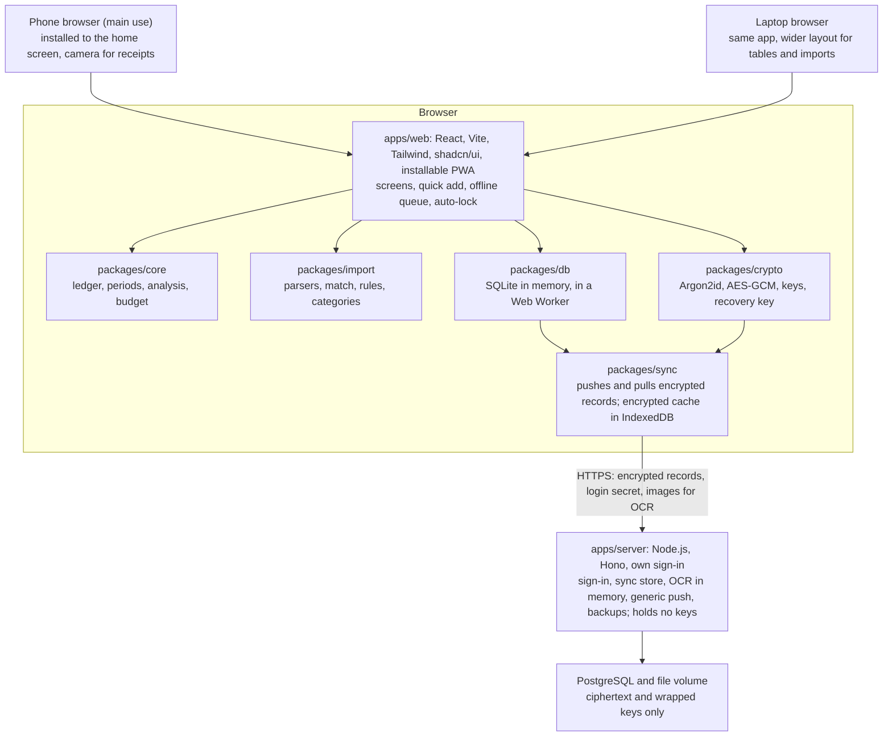

# Technology Stack

## Summary

Mirador is a phone-first, responsive React web app with a self-hosted TypeScript server and PostgreSQL. All user data is end-to-end encrypted. The browser holds the keys, keeps a local copy of the data and runs every calculation. The server stores and syncs ciphertext, handles sign-in and reads images for OCR in memory only. Everything ships as one Docker image, and every part is free and open source.

| Layer | Choice | License |
|---|---|---|
| Language | TypeScript (strict), in the browser and on the server | Apache-2.0 |
| Web app | React 19, Vite, TanStack Router | MIT |
| Styling and components | Tailwind CSS 4, shadcn/ui (on Radix primitives), Lucide icons | MIT, ISC |
| Screen state | TanStack Query over the local database, Zustand for UI state | MIT |
| Tables, lists, charts | TanStack Table with TanStack Virtual, Recharts through shadcn/ui charts | MIT |
| Forms and validation | React Hook Form and Zod | MIT |
| Installable and offline | PWA through vite-plugin-pwa (Workbox) | MIT |
| Encryption | WebCrypto (AES-256-GCM, HKDF), Argon2id through hash-wasm | Built into browsers, MIT |
| Local database | SQLite compiled to WebAssembly (@sqlite.org/sqlite-wasm), in memory, in a Web Worker; Drizzle ORM; Comlink | Public domain, Apache-2.0, MIT |
| Encrypted local cache | IndexedDB through Dexie | Apache-2.0 |
| Sync | Own record sync over REST (packages/sync) | AGPL-3.0 (ours) |
| Server | Node.js 24 LTS with Hono; REST API with OpenAPI generated from Zod | MIT |
| Server database | PostgreSQL with Drizzle ORM and drizzle-kit migrations | PostgreSQL License, Apache-2.0 |
| Accounts | Own sign-in module: username and password-derived login secret, cookie sessions; passkeys through @simplewebauthn/server | MIT |
| Import parsing | Papa Parse (CSV), own OFX parser, pdf.js (text PDFs), all in the browser | MIT, Apache-2.0 |
| OCR | PaddleOCR models through ONNX Runtime for Node (ppu-paddle-ocr), on the server, in memory | Apache-2.0, MIT |
| Money and dates | Integer minor units, decimal.js, date-fns | MIT |
| Push | Web Push with the web-push library | MPL-2.0 |
| Scheduled tasks | Croner, in the server process | MIT |
| Languages | i18next, English and Spanish | MIT |
| Tooling | pnpm workspaces, Turborepo, ESLint, Prettier | MIT |
| Tests | Vitest, Testing Library, Playwright on phone and desktop sizes, Testcontainers | MIT, Apache-2.0 |
| Packaging and CI | Docker image and Compose (app, PostgreSQL, Caddy), GitHub Actions, release-please | Apache-2.0 |

Principles:

- **Phone first.** Every screen is designed and tested at phone width first.
- **The server can't read your data.** Only the browser decrypts. The server sees the metadata listed in SEC-10 and nothing else (SEC-01 to SEC-04).
- **Mainstream tools.** React, Vite, Tailwind, shadcn/ui, SQLite and PostgreSQL have the most contributors, docs and answers.
- **One logic core.** Ledger, analysis, budget and import logic live in plain TypeScript packages that run in the browser (NFR-10).
- **Standard cryptography only.** Built-in WebCrypto and one widely used Argon2 library, no custom algorithms (SEC-13).
- **Free and open.** Open licenses compatible with AGPL-3.0; no accounts, API keys or telemetry (NFR-05, NFR-12).

## Requirements that drive the stack

Requirement IDs refer to the [Functional Requirements Specification](requirements.md).

| Requirement | What it forces |
|---|---|
| SEC-01 to SEC-04, SEC-09: end-to-end encryption, per-user keys | Keys made and kept in the browser. The server stores opaque records, so every query, total and search runs on the client |
| SEC-03: sign-in without the server learning the password | The browser derives a separate login secret from the password; the server only ever sees that |
| SEC-05: images read only in memory on the server | OCR in a request-scoped worker; uploads are never written to disk, a queue or logs |
| SEC-06, TXN-14, IMP-38: kept files encrypted | Files encrypted in the browser with their own key before upload |
| SEC-07, SEC-08: recovery key, password change | The data key is wrapped twice (password, recovery key); changing either re-wraps the key, never the data |
| SEC-11, SEC-12: encrypted offline queue, auto-lock | Nothing plaintext on the device's disk; keys and decrypted data live only in memory and are dropped on lock |
| SEC-14, SYS-12: generic push | Push carries a fixed reminder text; budget alerts are computed and shown in the app |
| Web first, mostly on a phone (WID, NFR-14) | A responsive, installable web app designed at phone width first |
| Online only, with an offline queue (WID-09 to WID-11) | Data is cached locally (encrypted) for reading; new transactions queue on the device until the server answers |
| One account per user, invites only (SYS-06, SYS-13) | Accounts and sessions on the server; no sharing between users in V1 |
| NFR-05: no third-party services | The browser talks only to its own server; the server's only outbound calls deliver push; users enter exchange rates (SYS-04, SYS-05) |
| IMP-04 to IMP-11, IMP-30, IMP-31: extraction with confidence, no remote AI | Parsers and a small OCR model that score each field; no generative model |
| IMP-24: pre-trained model only | Category suggestions from rules and history in V1; a later model must run in the browser |
| NFR-03: exact money | Integer minor units; decimal math for rates and interest |
| NFR-06: 100,000 transactions filtered in under 1 second | Indexed SQLite queries in a Web Worker on the device; a virtualized list on screen |
| NFR-08: no half-written data | One SQLite transaction per change locally; each sync push is accepted or rejected as a whole |
| NFR-10, NFR-11: shared, deterministic logic | Pure TypeScript packages for ledger, analysis, budget and import |
| DAT-01 to DAT-10: archive, backups | Archive built and decrypted in the browser; server backups hold ciphertext (DAT-09) |
| SYS-10, NFR-07, NFR-12, NFR-13 | EN and ES files, WCAG 2.2 AA checks, AGPL-3.0, tests named after requirement IDs |

## Architecture

The browser is the app. It holds the keys, the local database and all business logic. The server is an encrypted store with sign-in, sync, push and OCR. Screens never hold rules: they call packages/core, which reads packages/db, the local SQLite database.

Data is readable only in the browser; the server stores ciphertext.

Arrows point from a part to what it uses. Plaintext exists only inside the dashed browser box. In production one container serves the built web app and the API on one address. The folder layout is in the developer guide.

| Runs in the browser | Runs on the server |
|---|---|
| Key derivation, encryption, decryption, auto-lock | Sign-in, sessions, invites (own module) |
| Local SQLite database and encrypted cache | Encrypted records and files, per user |
| Ledger, budgets, analysis, goals, search, filters | Sync: hands out changes since a cursor |
| Import parsing, matching, categorization, rules | OCR of images and scanned PDFs, in memory |
| Recurring entries, posted on the next unlock | Generic push reminders at times the client sets |
| Archive export and import | Scheduled ciphertext backups |

## Web app and platforms

| Topic | Choice |
|---|---|
| Framework | React 19 with Vite. TanStack Router gives typed routes and deep links, so a dashboard card opens the filtered table (DSH-08, ANA-04) |
| Phone first | Designed at 375 px wide, then widened. Bottom tab bar on phones, sidebar on wide screens. Touch targets of at least 44 px; respects the notch and home indicator |
| Installable | Web app manifest and service worker (vite-plugin-pwa with Workbox): home-screen icon, full screen, instant load from cache |
| Offline | The encrypted cache makes all data readable offline after unlock. New transactions, including photos, queue on the device encrypted (SEC-11) and upload when the server answers (WID-09 to WID-11). Other edits need the server in V1 |
| Quick add | A floating button on every screen opens a sheet: camera, photo library or manual entry |
| Browsers | Current and previous major versions of Safari on iOS, Chrome on Android, and Chrome, Edge, Firefox and Safari on desktop |
| Native later | Capacitor can wrap this same app (adds a widget and share sheet); React Native means new screens. Waits for demand |

## UI, styling, charts and forms

Tailwind CSS 4 with shadcn/ui components, copied into the repo and built on accessible Radix primitives. Theme tokens come from the design document, in one CSS file.

| Need | Choice | Why |
|---|---|---|
| Components | shadcn/ui | Most common React component set; keyboard and screen reader support from Radix |
| Phone patterns | shadcn/ui Drawer and Sheet | Quick add, filters and details open as bottom sheets on phones, side panels on desktop |
| Icons | Lucide | Same set as shadcn/ui; stored as names in data (CAT-02) |
| Transaction table | TanStack Table with TanStack Virtual | Queries run in local SQLite (NFR-06); only visible rows render. Cards on phones |
| Charts | Recharts through shadcn/ui charts | Touch-friendly SVG; trends, pace, heatmaps (ANA-11, ANA-20, ANA-21), drill down (ANA-04), PNG export (ANA-35) |
| Data on screen | TanStack Query over the local database worker | Caching and refresh when sync brings changes |
| UI state | Zustand | Open filters, sheets |
| Forms | React Hook Form with Zod | The same schemas validate forms, records and archives (TXN-02, DAT-07) |

## Encryption and keys

All cryptography lives in packages/crypto, which wraps WebCrypto and hash-wasm. Keys are non-extractable WebCrypto keys held in the database worker's memory.

| Item | Design |
|---|---|
| Password key | Argon2id (hash-wasm) on the password with a per-user random salt. Starting parameters 64 MiB, 3 passes, tuned to about 1 second on a mid-range phone; stored per user so they can be raised later |
| Two keys from it | HKDF-SHA-256 splits the result into a login secret and a key-encryption key. Only the login secret leaves the browser (SEC-02, SEC-03) |
| Account key | A random 256-bit AES-GCM key made at sign-up. All data is encrypted with it. The server stores it only wrapped (encrypted) |
| Wrapping | The account key is wrapped twice: by the key-encryption key and by the recovery key (AES-KW) |
| Recovery key (SEC-07) | 256 random bits made in the browser at sign-up, shown once as grouped characters with a download option. HKDF splits it into a recovery login secret (the server stores only its hash) and a wrapping key |
| Forgotten password | The user enters the recovery key. The server checks the recovery secret, the browser unwraps the account key and sets a new password. No data is re-encrypted, and the server never sees a key |
| Password or recovery key change (SEC-08) | Re-wraps the account key and revokes other sessions on request. No data is re-encrypted |
| Records | Each record is JSON validated by Zod, encrypted with AES-256-GCM, a random 96-bit nonce, and the record id and schema version as associated data, so records can't be swapped or replayed |
| Files (SEC-06) | Each file gets its own random key and is encrypted in 1 MiB chunks; the file key is wrapped by the account key |
| Lock (SEC-12) | After the user's inactivity time, the worker drops the keys and the in-memory database. Unlock re-derives from the password |
| Passkeys | Passkeys sign in through WebAuthn. Where the browser supports the WebAuthn PRF extension, a passkey also unwraps the account key, so Face ID unlocks without the password. Otherwise the password is still asked to unlock |
| Server knowledge (SEC-10) | Username, sign-in times, record count, size and sync times, file sizes, push times. Record types live inside the ciphertext |

The admin can invite, disable and delete accounts, but cannot reset a password or read data. A user who loses both password and recovery key loses the data, and the app says so when the key is shown.

## Local data and sync

| Part | Design |
|---|---|
| Local database | SQLite (WebAssembly) in memory, in a Web Worker, queried with Drizzle's SQLite driver through Comlink. Indexes and FTS5 serve filters and search (NFR-06). Plaintext never touches the device's disk |
| Encrypted cache | IndexedDB (Dexie) holds the encrypted records, plus an encrypted snapshot of the whole SQLite database, so unlock is one decrypt instead of one per record |
| Server store | PostgreSQL table of records: user id, record id (UUIDv7, made in the browser), revision, ciphertext, deleted flag, updated time. Files in a disk volume, indexed by a table of the same shape |
| Pull | The client asks for changes since its last revision and decrypts them into SQLite |
| Push | The client sends a batch of encrypted records with the revision each was based on. The batch is accepted or rejected whole (NFR-08) |
| Conflicts | Per record, last write wins. With one user per account and online-only edits, two devices editing the same record at once is rare; the losing edit is shown in a notice |
| Retries | Record ids are made on the device, so a retried upload never duplicates |
| Deletes | Soft delete flag for undo (TXN-13), purged after the undo window |
| Period snapshots | Closed period snapshots (BUD-56) are records with no update path |

## Server and accounts

The server is Node.js 24 LTS with Hono and PostgreSQL through Drizzle. It has no business logic: it cannot, since it can't read the data.

| Part | Design |
|---|---|
| API | REST under /api. Requests and responses are Zod schemas in packages/api, which also generate an OpenAPI description and the typed client |
| Accounts | Own module in apps/server/src/auth. Sign-in with a username and the login secret; no email or name is stored. The login secret is hashed again on the server. Sessions are random tokens in Secure, HttpOnly, SameSite=Strict cookies, and the database keeps only their hashes. Attempts are limited per address and per username plus address. Passkeys (SYS-06) use @simplewebauthn/server |
| Sign-ups | The first account is the admin. Sign-ups are off by default; the admin sends invites (SYS-13) |
| Isolation | Every query is scoped to the session's user in one place; requests for another user's records are refused (SEC-09) |
| Tables | Accounts (username only), sessions (token hashes), key material (salt, Argon2 parameters, wrapped keys, recovery secret hash), records, files, push subscriptions, invites |
| Scheduled tasks | Croner in the server process: backups, purges, push sends. No job queue, since OCR never stores its input |
| Backups (DAT-09) | Scheduled pg_dump plus the file volume, to a folder the admin chooses, keeping the last 14. Backups hold ciphertext only |
| Migrations | Generated by drizzle-kit, committed, run at start after an automatic backup (DAT-10) |

## Money and dates

- Amounts are integers in the currency's minor unit with an ISO 4217 code, handled through the Money helpers in packages/core (NFR-03).
- Rates and interest use decimal.js, then round to minor units half to even.
- Exchange rates are records the user enters with a date (SYS-04, SYS-05); conversions use the rate valid on the transaction date.
- A transaction date is a calendar date plus an optional local time, so it never shifts with time zones.
- Budget periods (SYS-02) and all period math live in packages/core with date-fns. A period starting on the 31st starts on the last day of shorter months.

## Import and extraction

Parsing, matching and categorization run in the browser in packages/import. Only images and scanned PDFs go to the server, for OCR. No generative model is used, so every field has a confidence score and the same file always gives the same result (IMP-08, NFR-11).

| Input | Read text with | Where |
|---|---|---|
| CSV (IMP-02, IMP-03, DAT-12) | Papa Parse, with a saved column mapping per bank and wallet | Browser |
| OFX, QFX (IMP-06) | Own parser for OFX 1.x and 2.x | Browser |
| Text PDF statements (IMP-04) | pdf.js, text with positions | Browser |
| Images, scanned PDFs, screenshots (IMP-05) | PaddleOCR | Server, in memory |
| Receipt or bank notification photo (IMP-07, quick add) | PaddleOCR | Server, in memory |

OCR on the server (IMP-11, SEC-05):

- The browser sends one picture at a time over HTTPS (`POST /api/ocr`). The server keeps it in memory, runs OCR in a worker thread and returns words with their boxes and confidence. Nothing is written to disk, to the database or to logs, and the bytes are cleared before the response.
- ppu-paddle-ocr runs PaddleOCR models through ONNX Runtime for Node. The model files ship in the Docker image and are listed in MODELS.md; the image is Debian-based because ONNX Runtime's native library needs glibc.
- The browser turns everything into JPEG first: HEIC photos (which the iPhone's browser decodes), big photos (scaled down) and the pages of a scanned PDF (drawn with pdf.js). The server only ever decodes JPEG, PNG and WebP.
- One OCR at a time by default, so a small server stays responsive. If the server restarts mid-OCR, the browser retries.

After OCR, everything happens in the browser:

1. Parse: layout parser finds the transaction table from text positions; the receipt parser finds the total, date and merchant.
1. Normalize: amounts to minor units, dates to calendar dates, descriptors cleaned with the user's mappings (IMP-27).
1. Match: duplicates, merges with hand-logged entries, and transfers (IMP-20 to IMP-22). Queued offline entries meet statement rows here.
1. Categorize: user rules, then identical past descriptions (IMP-23).
1. Score and flag: fields below the user's threshold (SYS-08) are flagged (IMP-10, IMP-31).
1. Commit: one local transaction and one sync batch per import, undoable as a unit (IMP-34, IMP-35).

Category suggestions (IMP-24, Could). V1 uses rules and history only. A later version can add a pre-trained multilingual embedding model run in the browser with Transformers.js or ONNX Runtime Web, served from the user's own server. Its weights never change, and it only suggests the user's own categories (CAT-10). The model is picked by benchmark for size and accuracy on phones.

Accuracy is measured: a corpus of synthetic and donated, anonymized statements and receipts in English and Spanish runs in CI on every change to packages/import, and fails below the spec's targets (99% for CSV and text PDFs, 90% for clear images).

About Jev. Jev (TypeSafe AI) returns a typed choice instead of free text, which is the right idea, but it is hosted only, closed source and text only. The pipeline keeps the idea locally: every decision is a typed choice with a score.

Ruled out: generative vision-language models (large, slow, unscored output), LayoutLMv3 (non-commercial weights), Google ML Kit and cloud OCR (closed or third-party), Tesseract (weaker on receipt photos).

## Device features in the browser

| Feature | Requirement | How |
|---|---|---|
| Quick add | WID-02 to WID-07 | Floating button opens a bottom sheet: camera, photo library or manual, most used categories first |
| Camera and photos | IMP-05, IMP-07 | File input with capture opens the camera or library; drag and drop on desktop |
| Offline capture | WID-09 to WID-11, SEC-11 | Entries and photos wait encrypted in IndexedDB with a "waiting to upload" count |
| File import and export | IMP-01, DAT-01, DAT-02 | File picker for imports; archives and CSVs download as files |
| Sign-in and unlock | SYS-06, SEC-03, SEC-12 | Password, or a passkey with Face ID or a fingerprint; PRF unlock where supported |
| Notifications | SYS-11, SYS-12, SEC-14 | In-app list computed on the device. Web Push carries only a generic reminder text, encrypted in transit |
| Kept receipts | TXN-14, IMP-38, SEC-06 | Encrypted in the browser, stored on the server's file volume |

Not possible in a browser: home-screen widgets (quick-add button instead), the iPhone share sheet (upload from inside the app), and uploads while the app is closed (the queue sends on next open).

## Languages, privacy and security

Languages (SYS-10). i18next with react-i18next, one JSON file per language and feature in packages/i18n (en, es). The browser's language is the default; users can change it. A lint rule rejects literal strings in JSX. Import parsers read both languages' month names, decimal separators and keywords regardless of the UI language. More languages can come through Weblate.

No third parties (NFR-05):

- A Content Security Policy only allows connections to the app's own server.
- The server makes no outbound connections except Web Push delivery to the browser's push service. A test runs the container with other outbound traffic blocked.
- CI rejects packages that phone home (analytics, crash reporting, remote config).
- No fonts, scripts or images from CDNs.

Security:

- HTTPS always (NFR-09). Compose includes Caddy, which gets a Let's Encrypt certificate; renewing it is Caddy's only outbound connection. Hosts that provide HTTPS can skip Caddy.
- The served code is the trust anchor: whoever controls the server could ship a changed app that captures passwords. Mitigations are a strict CSP, Subresource Integrity on every asset, reproducible builds and published hashes per release, so a user can check what they run.
- No plaintext in logs: request bodies are never logged, and a test searches logs for known test strings.
- Crypto code is limited to packages/crypto, covered by published test vectors, and gets an outside review before 1.0.
- Uploaded files are checked by type and size before OCR.
- Supply chain: committed lockfile, Dependabot, secret scanning, CodeQL, signed images, SECURITY.md with private reporting.

## Testing, CI and deployment

Every Must requirement gets an automated test whose name starts with its ID (NFR-13). GitHub Actions runs them on every pull request.

| Level | Tool | Covers |
|---|---|---|
| Logic | Vitest | packages/core, import, archive, sync: ledger, periods, baseline, month budgets, matching, parsers, conflict rules |
| Crypto | Vitest | Known-answer vectors, wrap and unwrap, recovery, password change, tampered or swapped records rejected |
| Server | Vitest with Testcontainers (real PostgreSQL) | API, isolation between users, sync revisions, migrations |
| Zero knowledge | Vitest and Playwright | Seed data with marker strings, then scan the database, file volume, backups and logs for them: none may appear (SEC-04, SEC-05) |
| Components | Vitest with React Testing Library | Screens, forms, quick-add sheet |
| End to end | Playwright on iPhone and Android sizes plus desktop, in WebKit, Chromium and Firefox, with axe-core | Main flows, lock and unlock, recovery, offline queue, WCAG 2.2 AA (NFR-07) |
| Extraction accuracy | Vitest over the corpus | IMP targets |
| Round trip | Vitest | Export then import into an empty account equals the original (DAT-04) |
| Performance | 100,000 seeded transactions; Lighthouse CI on a throttled phone profile | NFR-06, unlock time, Argon2 time, page weight |

Each release is also checked by hand in Safari on an iPhone and Chrome on an Android phone.

Deployment:

- One Docker image per release on GitHub Container Registry: server, built web app and OCR models, for 64-bit Intel and ARM.
- Docker Compose with three services: the app, PostgreSQL and Caddy. Start with `docker compose up -d`.
- Upgrades pull the new image; the server backs up, then migrates at start (DAT-10). Client-side data migrations run in the browser after unlock.
- SemVer releases with release-please. Details in the developer guide.

## Hosting

Whoever runs the app chooses the host. It needs Linux with Docker, a persistent disk, HTTPS, and about 1 GB of memory, mostly for OCR (to be measured). Budget and analysis work runs on the phone, so the server stays light.

| Option | Fits | Watch out for |
|---|---|---|
| Small VPS (a few dollars a month) | Most people: always on, independent of home power and internet | OS updates and off-host backups are the admin's job |
| Free cloud tier with an always-free VM | Zero cost | Terms and capacity change |
| Container host with managed PostgreSQL | No server to maintain | Free plans sleep, wipe disks or expire databases; files need a persistent volume |
| Home server or NAS behind a VPN (Tailscale, Headscale, WireGuard) | Full control | Outages with home power or internet |

A step-by-step guide for one tested VPS setup comes with the docs, plus generic Compose instructions. The project never runs a hosted version.

## Licensing and dependency policy

Every dependency, model file and tool the app ships must be open source under an AGPL-3.0-compatible license, with no account, API key or paid plan.

| Allowed | Review first | Not allowed |
|---|---|---|
| MIT, ISC, BSD-2/3-Clause, Apache-2.0, Zlib, 0BSD, Unlicense, CC0, public domain | MPL-2.0, LGPL, GPL-3.0, AGPL-3.0, CC-BY (data and models) | Proprietary or closed binaries, non-commercial (CC-BY-NC), SSPL, BSL, "source available", hosted-only services |

CI checks every installed package's license; model files list theirs in MODELS.md. Build-only tools (Docker, GitHub Actions) only need to be free to use. AGPL-3.0 means anyone who runs a modified version for others must share the changes.

## Alternatives considered

| Option | Why not chosen |
|---|---|
| Server-readable data with encryption at rest only | Simpler, and the server could run queries and jobs, but the operator could read everything (fails SEC-04) |
| OPAQUE (password-authenticated key exchange) | Stronger sign-in in theory, but JavaScript libraries are young; a derived login secret is the proven Bitwarden pattern and meets SEC-03 |
| libsodium instead of WebCrypto | Fine choice, but WebCrypto is built in, fast and keeps keys non-extractable; only Argon2 needs a library |
| SQLite persisted on the device (OPFS) | Would put plaintext on disk; encrypted SQLite builds (SQLCipher in WebAssembly) are less standard |
| Sync products (PowerSync, ElectricSQL, CRDTs like Automerge) | Built around a server that reads the data, or more machinery than one user per account needs |
| OCR in the browser | Best privacy, but slow on phones and a large model download; possible later since ppu-paddle-ocr runs on the web too |
| Expo (React Native) | Adds a native toolchain with no App Store release planned; an option for native apps later |
| Native apps plus web from the start | Two builds to test, and Apple's paid account to distribute |
| Next.js or Remix | Server rendering can't help when the server can't read the data |
| MongoDB or another document database | The data is relational and the screens are aggregations |
| Python service for OCR | A second runtime in the image; ONNX Runtime in Node runs the same models |
| A local or hosted LLM for extraction | Large, slow, and no per-field confidence |
| Better Auth | Needs an email and a name, and recovery, password change and passkey unlock all re-wrap keys outside it; a small own module is less code to trust (ADR 0002) |

## Risks

| Risk | Impact | Mitigation |
|---|---|---|
| User loses password and recovery key | Data gone for good | Clear warning when the key is shown, a download option, a reminder to store it, archive export |
| Tampered app served by a compromised server | Passwords or keys captured | CSP, SRI, reproducible builds, published hashes, signed images |
| Bug in our crypto code | Data exposed or unreadable | Standard primitives only, test vectors, zero-knowledge tests, outside review before 1.0 |
| Slow unlock or memory pressure on older phones with 100,000 transactions | Long waits, browser kills the tab | Encrypted snapshot for one-step unlock; measure early; Argon2 parameters tuned per device class |
| Cheap hosts sleep, wipe disks or change terms | Lost data on the server | Persistent volume required; off-host backups; the devices' encrypted caches can re-seed a new server |
| Phone browser quirks, mainly Safari | Broken screens | Playwright WebKit at phone sizes in CI, manual iPhone check per release |
| OCR slow or inaccurate on a small server | Slow imports, many fixes | One OCR at a time, progress shown; corpus with CI accuracy gates; unsure fields flagged |
| Metadata reveals usage patterns | Partial privacy loss | Documented in full (SEC-10); record types and sizes kept inside ciphertext where possible |

## Open questions

1. Recommended host for the step-by-step guide, picked after testing two or three cheap options.
1. Argon2id parameters, set after measuring on a few real phones.

## Sources

- Bitwarden security whitepaper (password-derived keys, login hash, wrapped keys)
- Actual Budget end-to-end encryption docs (local SQLite plus encrypted sync)
- OWASP Password Storage Cheat Sheet (Argon2id parameters)
- W3C WebAuthn Level 3 (PRF extension) and the SQLite WebAssembly docs
- ppu-paddle-ocr README (license, Node and web support)
- Jev on OpenRouter and Real Python's Jev reference (hosted only, text only)

